<!-- Generated by .github/profile/build_static.py. Edit content.py, then re-run it. -->

<picture><source media="(prefers-color-scheme: dark)" srcset="https://raw.githubusercontent.com/Thulnith-0/Thulnith-0/main/assets/hero-dark.svg"></picture>

<picture><source media="(prefers-color-scheme: dark)" srcset="https://raw.githubusercontent.com/Thulnith-0/Thulnith-0/main/assets/now-dark.svg"></picture>

<picture><source media="(prefers-color-scheme: dark)" srcset="https://raw.githubusercontent.com/Thulnith-0/Thulnith-0/main/assets/terminal-dark.svg"></picture>

<picture><source media="(prefers-color-scheme: dark)" srcset="https://raw.githubusercontent.com/Thulnith-0/Thulnith-0/main/assets/sections/highlights-dark.svg"></picture>

<picture><source media="(prefers-color-scheme: dark)" srcset="https://raw.githubusercontent.com/Thulnith-0/Thulnith-0/main/assets/highlights-dark.svg"></picture>

 

<picture><source media="(prefers-color-scheme: dark)" srcset="https://raw.githubusercontent.com/Thulnith-0/Thulnith-0/main/assets/sections/work-dark.svg"></picture>

<picture><source media="(prefers-color-scheme: dark)" srcset="https://raw.githubusercontent.com/Thulnith-0/Thulnith-0/main/assets/projects/sinhala-tts-dark.svg"></picture> <picture><source media="(prefers-color-scheme: dark)" srcset="https://raw.githubusercontent.com/Thulnith-0/Thulnith-0/main/assets/projects/raawa-dark.svg"></picture>

<picture><source media="(prefers-color-scheme: dark)" srcset="https://raw.githubusercontent.com/Thulnith-0/Thulnith-0/main/assets/projects/crowdeye-dark.svg"></picture> <picture><source media="(prefers-color-scheme: dark)" srcset="https://raw.githubusercontent.com/Thulnith-0/Thulnith-0/main/assets/projects/cri-dark.svg"></picture>

<picture><source media="(prefers-color-scheme: dark)" srcset="https://raw.githubusercontent.com/Thulnith-0/Thulnith-0/main/assets/projects/clamp-dark.svg"></picture> <a href="https://github.com/Thulnith-0/Easy-AI-Sub"><picture><source media="(prefers-color-scheme: dark)" srcset="https://raw.githubusercontent.com/Thulnith-0/Thulnith-0/main/assets/projects/easy-ai-sub-dark.svg"></picture></a>

<a href="https://github.com/Thulnith-0/AutoTyper"><picture><source media="(prefers-color-scheme: dark)" srcset="https://raw.githubusercontent.com/Thulnith-0/Thulnith-0/main/assets/projects/autotyper-dark.svg"></picture></a> <a href="https://github.com/Thulnith-0/antigravity-delegate"><picture><source media="(prefers-color-scheme: dark)" srcset="https://raw.githubusercontent.com/Thulnith-0/Thulnith-0/main/assets/projects/antigravity-delegate-dark.svg"></picture></a>

<picture><source media="(prefers-color-scheme: dark)" srcset="https://raw.githubusercontent.com/Thulnith-0/Thulnith-0/main/assets/projects/firestack-dark.svg"></picture> <picture><source media="(prefers-color-scheme: dark)" srcset="https://raw.githubusercontent.com/Thulnith-0/Thulnith-0/main/assets/projects/hydra-panel-dark.svg"></picture>

 

<picture><source media="(prefers-color-scheme: dark)" srcset="https://raw.githubusercontent.com/Thulnith-0/Thulnith-0/main/assets/sections/journey-dark.svg"></picture>

<picture><source media="(prefers-color-scheme: dark)" srcset="https://raw.githubusercontent.com/Thulnith-0/Thulnith-0/main/assets/journey-dark.svg"></picture>

 

<picture><source media="(prefers-color-scheme: dark)" srcset="https://raw.githubusercontent.com/Thulnith-0/Thulnith-0/main/assets/sections/stack-dark.svg"></picture>

<picture><source media="(prefers-color-scheme: dark)" srcset="https://raw.githubusercontent.com/Thulnith-0/Thulnith-0/main/assets/marquee-dark.svg"></picture>

<picture><source media="(prefers-color-scheme: dark)" srcset="https://raw.githubusercontent.com/Thulnith-0/Thulnith-0/main/assets/stack-dark.svg"></picture>

 

<picture><source media="(prefers-color-scheme: dark)" srcset="https://raw.githubusercontent.com/Thulnith-0/Thulnith-0/main/assets/sections/github-dark.svg"></picture>

<picture><source media="(prefers-color-scheme: dark)" srcset="https://raw.githubusercontent.com/Thulnith-0/Thulnith-0/output/stats-dark.svg"></picture> <picture><source media="(prefers-color-scheme: dark)" srcset="https://raw.githubusercontent.com/Thulnith-0/Thulnith-0/output/streak-dark.svg"></picture>

<picture><source media="(prefers-color-scheme: dark)" srcset="https://raw.githubusercontent.com/Thulnith-0/Thulnith-0/output/overview-dark.svg"></picture>

<picture><source media="(prefers-color-scheme: dark)" srcset="https://raw.githubusercontent.com/Thulnith-0/Thulnith-0/output/heatmap-dark.svg"></picture>

<picture><source media="(prefers-color-scheme: dark)" srcset="https://raw.githubusercontent.com/Thulnith-0/Thulnith-0/output/rhythm-dark.svg"></picture>

<picture><source media="(prefers-color-scheme: dark)" srcset="https://raw.githubusercontent.com/Thulnith-0/Thulnith-0/output/activity-dark.svg"></picture>

<picture><source media="(prefers-color-scheme: dark)" srcset="https://raw.githubusercontent.com/Thulnith-0/Thulnith-0/output/languages-dark.svg"></picture>

<picture><source media="(prefers-color-scheme: dark)" srcset="https://raw.githubusercontent.com/Thulnith-0/Thulnith-0/output/achievements-dark.svg"></picture>

<picture><source media="(prefers-color-scheme: dark)" srcset="https://raw.githubusercontent.com/Thulnith-0/Thulnith-0/output/github-contribution-grid-snake-dark.svg"></picture>

<picture><source media="(prefers-color-scheme: dark)" srcset="https://raw.githubusercontent.com/Thulnith-0/Thulnith-0/output/joke-dark.svg"></picture>

 

<picture><source media="(prefers-color-scheme: dark)" srcset="https://raw.githubusercontent.com/Thulnith-0/Thulnith-0/main/assets/sections/connect-dark.svg"></picture>

<a href="https://github.com/Thulnith-0"><picture><source media="(prefers-color-scheme: dark)" srcset="https://raw.githubusercontent.com/Thulnith-0/Thulnith-0/main/assets/social/github-dark.svg"></picture></a> <a href="https://www.linkedin.com/in/thulnith-perera-42b0bb346"><picture><source media="(prefers-color-scheme: dark)" srcset="https://raw.githubusercontent.com/Thulnith-0/Thulnith-0/main/assets/social/linkedin-dark.svg"></picture></a> <a href="https://www.instagram.com/thulnith__/"><picture><source media="(prefers-color-scheme: dark)" srcset="https://raw.githubusercontent.com/Thulnith-0/Thulnith-0/main/assets/social/instagram-dark.svg"></picture></a> <a href="https://www.tiktok.com/@_thulnith_"><picture><source media="(prefers-color-scheme: dark)" srcset="https://raw.githubusercontent.com/Thulnith-0/Thulnith-0/main/assets/social/tiktok-dark.svg"></picture></a> <a href="https://www.facebook.com/thulnith.perera.98/"><picture><source media="(prefers-color-scheme: dark)" srcset="https://raw.githubusercontent.com/Thulnith-0/Thulnith-0/main/assets/social/facebook-dark.svg"></picture></a> <a href="https://discord.com/users/922739470837637241"><picture><source media="(prefers-color-scheme: dark)" srcset="https://raw.githubusercontent.com/Thulnith-0/Thulnith-0/main/assets/social/discord-dark.svg"></picture></a> <a href="mailto:thulnithperera870@gmail.com"><picture><source media="(prefers-color-scheme: dark)" srcset="https://raw.githubusercontent.com/Thulnith-0/Thulnith-0/main/assets/social/gmail-dark.svg"></picture></a>

<picture><source media="(prefers-color-scheme: dark)" srcset="https://raw.githubusercontent.com/Thulnith-0/Thulnith-0/main/assets/footer-dark.svg"></picture>

